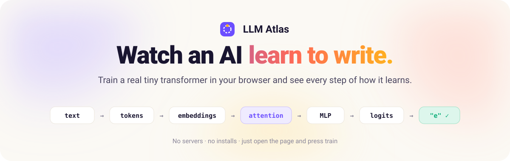
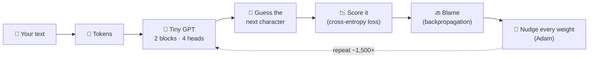

<p align="center">
  <a href="https://purvanshsingh.github.io/LLM-Atlas/"></a>
</p>

<p align="center">
  <a href="https://purvanshsingh.github.io/LLM-Atlas/"></a>
  
  
</p>

<p align="center">
  <b>Type any text. Press train. Watch a real transformer learn it, step by step.</b><br>
  A visual, hands-on companion to building a large language model from scratch.
</p>

---

## ✨ What is this?

**LLM Atlas** turns the ideas behind GPT-style language models into something you can see and play with.
A tiny transformer, the same design behind ChatGPT but millions of times smaller, trains **live in your browser**
on whatever text you give it: a poem, a recipe, some code, or your own words.

You watch its writing go from random noise to your text, and you can look inside at every step on the way.

<p align="center">
  <a href="https://purvanshsingh.github.io/LLM-Atlas/"><b>→ Open the live site</b></a>
</p>

## 🧭 The journey

| | Section | What you see |
|:-:|---|---|
| 01 | **The training loop** | *Guess → Score → Blame → Nudge*, animated as it runs. A live loss curve compares your text with text it never trained on, so overfitting appears on its own, and samples of its writing are saved at each milestone. |
| 02 | **Inside the model** | Your words flowing through the network, Transformer-Explainer style: tokens → embeddings → query · key · value → masked multi-head attention → shortcut → GELU MLP → next-letter odds. Every square is a real number from the model, with a guided walkthrough and a live view of the backward pass. |
| 03 | **One guess, up close** | A single next-character quiz from your text, showing its top guesses and the loss for that one answer. |
| 04 | **What letters mean to it** | A live 2D map of the learned character embeddings. Hover over a letter to see its nearest neighbours. |
| 05 | **Your turn** | Start a sentence and let it finish, with a creativity (temperature) slider and a confidence highlight on every letter. |
| ⚙️ | **Under the hood** | Separate playgrounds for a BPE tokenizer, attention maths, GPT-2 sizes with exact parameter counts, and temperature / top-k sampling. |

## 🔁 How training works



## 📚 From the book to the screen

LLM Atlas follows the path of Sebastian Raschka's *Build a Large Language Model (From Scratch)*.

| Book chapter | Where to see it |
|---|---|
| Ch 2 · Working with text data | Tokens and embeddings (*Inside the model*, steps 1–2; *Under the hood*) |
| Ch 3 · Coding attention mechanisms | Masked multi-head attention (*Inside the model*, steps 3–4) |
| Ch 4 · Implementing a GPT model | Shortcuts, LayerNorm, GELU MLP, and GPT-2 sizes (*Under the hood*) |
| Ch 5 · Pretraining on unlabeled data | The training loop, loss, overfitting, temperature and generation |

## 🛠️ Under the hood

- **`tinygpt.js`**: a dependency-free, character-level GPT written from scratch. It has token and position embeddings, pre-LayerNorm blocks with causal multi-head attention and a GELU MLP, its own small autograd engine, and Adam with gradient clipping (about 28K weights). Its gradients are verified against numerical gradients.
- **`trainer-worker.js`**: runs training in a Web Worker so the page stays smooth, streaming fresh weights back about 8 times a second.
- **Fully static**: plain HTML, CSS and JavaScript. No build step, no server, no API keys.

## 💻 Run it locally

```bash
git clone https://github.com/Purvanshsingh/LLM-Atlas.git
cd LLM-Atlas
python3 -m http.server 8000
```

Then open **http://localhost:8000**.

## 💜 Credits

Made with ♥ by **Purvansh**: [connect on LinkedIn](https://www.linkedin.com/in/purvanshsingh/).

An independent educational project inspired by Sebastian Raschka's *Build a Large Language Model (From Scratch)* (Manning).
